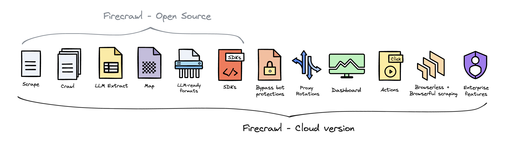

<h3 align="center">
  <a name="readme-top"></a>
  
</h3>

<div align="center">
  <a href="https://github.com/firecrawl/firecrawl/blob/main/LICENSE">
    
  </a>
  <a href="https://pepy.tech/project/firecrawl-py">
    
  </a>
  <a href="https://GitHub.com/firecrawl/firecrawl/graphs/contributors">
    
  </a>
  <a href="https://firecrawl.dev">
    
  </a>
</div>

<div>
  <p align="center">
    <a href="https://twitter.com/firecrawl">
      
    </a>
    <a href="https://www.linkedin.com/company/104100957">
      
    </a>
    <a href="https://discord.gg/firecrawl">
      
    </a>
  </p>
</div>

---

# **🔥 Firecrawl**

**Knowledge infrastructure to make your agents smarter. 🔥** You can use Firecrawl three ways. This repo holds the code for Firecrawl Local and the self-hosted server, along with SDKs that work with all three.

- **[Firecrawl Local](#firecrawl-local).** Run Firecrawl on your own machine as one binary that turns websites into clean markdown, plugs into your AI agent as an MCP server and serves the Firecrawl API on localhost.
- **[Firecrawl Cloud](#firecrawl-cloud).** Use the hosted service at [firecrawl.dev](https://firecrawl.dev/?ref=github) for everything Local does at scale with nothing to run, plus search and the 550+ data providers in [Firecrawl Alexandria](https://alexandria.firecrawl.dev) for far more knowledge than scraping alone.
- **[Self-hosting](#self-hosting).** Deploy the full Firecrawl server from `apps/api` with its own queues, workers and databases on your own infrastructure.

_Pst. Hey, you, join our stargazers :)_

<a href="https://github.com/firecrawl/firecrawl">
  
</a>

---

## Firecrawl Local

[Firecrawl Local](apps/local) scrapes, crawls and maps from your own machine without a database, queue or container, and it reaches Firecrawl Cloud when your AI agents need search or Alexandria. It installs from crates.io. You need Rust and a C compiler, which on macOS means `xcode-select --install` and on Debian or Ubuntu means `build-essential`.

```bash
cargo install firecrawl-local
```

If you don't have Rust, [Firecrawl Cloud](#firecrawl-cloud) runs the same scrape with nothing to build and no signup.

```bash
npx -y firecrawl-cli@latest scrape https://firecrawl.dev
```

Scrape a page and print its markdown.

```bash
firecrawl-local scrape https://firecrawl.dev --markdown
```

Crawl a site and save one markdown file per page.

```bash
firecrawl-local crawl https://docs.firecrawl.dev --limit 50 --out ./pages
```

List every URL on a site.

```bash
firecrawl-local map https://firecrawl.dev
```

Pages that need JavaScript render in the Chrome or Chromium already on your machine, and PDFs and Office documents are parsed locally too. Without a browser, static pages still work and a page that needed one comes back with a warning.

### Add it to your AI agent

`init` finds Claude Code, Claude Desktop, Cursor, Windsurf, Gemini CLI and Codex on your machine and adds Firecrawl Local to each one as an MCP server. It backs up every config file first, and the MCP server itself needs Node.js 22 or newer.

```bash
firecrawl-local init
```

Restart your AI tool afterwards. Its scrape, crawl, map and batch scrape tools run on your machine, and the other Firecrawl tools go to Firecrawl Cloud.

### Run the Firecrawl API on localhost

`serve` answers the Firecrawl v2 API on port 3002, so code written for Firecrawl runs against it unchanged and local routes need no API key.

```bash
firecrawl-local serve
```

Point any Firecrawl SDK at it by setting the API URL.

```python
from firecrawl import Firecrawl

app = Firecrawl(api_url="http://localhost:3002")
print(app.scrape("https://firecrawl.dev").markdown)
```

The [Firecrawl Local README](apps/local) covers every command and option, the security defaults for `serve` and running it in Docker. Move to [Firecrawl Cloud](#firecrawl-cloud) when you need structured JSON, Interact, the Agent or scale beyond one machine.

---

## What runs where

| Feature | Firecrawl Local | Firecrawl Cloud |
|---------|-----------------|-----------------|
| [Scrape](#scrape) | Markdown, HTML, raw HTML and links | Adds structured JSON, summaries, screenshots and browser actions |
| [Crawl](#crawl), [Map](#map) and [Batch Scrape](#batch-scrape) | ✅ | ✅ |
| PDFs and Office documents | ✅ | ✅, plus [Parse](https://docs.firecrawl.dev/features/parse) for uploaded files |
| [Search](#search) | Through Firecrawl Cloud, no account needed | ✅ |
| [Alexandria](#alexandria) | Through Firecrawl Cloud after `firecrawl-local login` | ✅ |
| [Interact](#interact), [Agent](#agent) and [Monitor](https://docs.firecrawl.dev/features/monitoring) | | ✅ |

Scraping, crawling and mapping run on your machine. By default a single-page scrape that won't load there is fetched by Firecrawl Cloud instead and marked `"source": "firecrawl-cloud"` in the result. Those Cloud calls work without an account at a limited rate, and `firecrawl-local login` puts them on your Firecrawl account. Set `FIRECRAWL_CLOUD=off` to keep everything on your machine.

---

## Firecrawl Cloud

Firecrawl Cloud runs everything Firecrawl Local does at scale, with no browser or machine of your own to look after. It also gives your AI agents access to far more knowledge than scraping alone, with search, Alexandria, Interact and Agent all through a single API.

- **Works on the real web.** Covers 96% of the web, including JS-heavy pages and dynamic apps ([see benchmarks](https://www.firecrawl.dev/blog/the-worlds-best-web-data-api-v25)).
- **Fast.** P95 latency of 3.4s across millions of pages, built for real-time AI agents and dynamic apps.
- **LLM-ready output.** Clean markdown, structured JSON, screenshots and more, so your AI agents spend fewer tokens.

[Firecrawl Keyless](https://www.firecrawl.dev/blog/firecrawl-keyless-launch) gives you 1,000 free credits a month with no API key or signup across MCP, the CLI and the API. For an API key, sign up at [firecrawl.dev](https://firecrawl.dev) and try it in the [playground](https://firecrawl.dev/playground).

### Search

Search the web and get full content from results.

```python
from firecrawl import Firecrawl

app = Firecrawl(api_key="fc-YOUR_API_KEY")

search_result = app.search("firecrawl", limit=5)
```

<details>
<summary><b>Node.js / cURL / CLI</b></summary>

**Node.js**
```javascript
import { Firecrawl } from 'firecrawl';

const app = new Firecrawl({apiKey: "fc-YOUR_API_KEY"});

app.search("firecrawl", { limit: 5 })
```

**cURL**
```bash
curl -X POST 'https://api.firecrawl.dev/v2/search' \
-H 'Authorization: Bearer fc-YOUR_API_KEY' \
-H 'Content-Type: application/json' \
-d '{
  "query": "firecrawl",
  "limit": 5
}'
```

**CLI**
```bash
firecrawl search "firecrawl" --limit 5
```
</details>

```json
[
  {
    "url": "https://firecrawl.dev",
    "title": "Firecrawl",
    "markdown": "Turn websites into..."
  },
  {
    "url": "https://docs.firecrawl.dev",
    "title": "Firecrawl Docs",
    "markdown": "# Getting Started..."
  }
]
```

### Scrape

Get LLM-ready context from any website as markdown, JSON, screenshots and more.

```python
from firecrawl import Firecrawl

app = Firecrawl(api_key="fc-YOUR_API_KEY")

result = app.scrape('firecrawl.dev')
```

<details>
<summary><b>Node.js / cURL / CLI</b></summary>

**Node.js**
```javascript
import { Firecrawl } from 'firecrawl';

const app = new Firecrawl({ apiKey: "fc-YOUR_API_KEY" });

app.scrape('firecrawl.dev')
```

**cURL**
```bash
curl -X POST 'https://api.firecrawl.dev/v2/scrape' \
-H 'Authorization: Bearer fc-YOUR_API_KEY' \
-H 'Content-Type: application/json' \
-d '{
  "url": "firecrawl.dev"
}'
```

**CLI**
```bash
firecrawl scrape https://firecrawl.dev
firecrawl https://firecrawl.dev --only-main-content
```
</details>

```
# Firecrawl

Firecrawl helps AI agents search, scrape, and interact with the web.

## Features
- Search: Find information across the web
- Scrape: Clean data from any page
- Interact: Click, navigate, and operate pages
- Agent: Autonomous data gathering
```

### Interact

Scrape a page, then interact with it using AI prompts or code.

```python
from firecrawl import Firecrawl

app = Firecrawl(api_key="fc-YOUR_API_KEY")

result = app.scrape("https://amazon.com")
scrape_id = result.metadata.scrape_id

app.interact(scrape_id, prompt="Search for 'mechanical keyboard'")
app.interact(scrape_id, prompt="Click the first result")
```

<details>
<summary><b>Node.js / cURL / CLI</b></summary>

**Node.js**
```javascript
import { Firecrawl } from 'firecrawl';

const app = new Firecrawl({apiKey: "fc-YOUR_API_KEY"});

const result = await app.scrape("https://amazon.com");

await app.interact(result.metadata.scrapeId, {
  prompt: "Search for 'mechanical keyboard'"
});
await app.interact(result.metadata.scrapeId, {
  prompt: "Click the first result"
});
```

**cURL**
```bash
# 1. Scrape the page
curl -X POST 'https://api.firecrawl.dev/v2/scrape' \
-H 'Authorization: Bearer fc-YOUR_API_KEY' \
-H 'Content-Type: application/json' \
-d '{"url": "https://amazon.com"}'

# 2. Interact with the page (use scrapeId from step 1)
curl -X POST 'https://api.firecrawl.dev/v2/scrape/SCRAPE_ID/interact' \
-H 'Authorization: Bearer fc-YOUR_API_KEY' \
-H 'Content-Type: application/json' \
-d '{"prompt": "Search for mechanical keyboard"}'
```

**CLI**
```bash
firecrawl scrape https://amazon.com
firecrawl interact exec --prompt "Search for 'mechanical keyboard'"
firecrawl interact exec --prompt "Click the first result"
```
</details>

```json
{
  "success": true,
  "output": "Keyboard available at $100",
  "liveViewUrl": "https://liveview.firecrawl.dev/..."
}
```

### Agent

Describe what you need, and our AI agent searches, navigates and retrieves it with no URLs required.

```bash
curl -X POST 'https://api.firecrawl.dev/v2/agent' \
  -H 'Authorization: Bearer fc-YOUR_API_KEY' \
  -H 'Content-Type: application/json' \
  -d '{
    "prompt": "Find the pricing plans for Notion"
  }'
```

```json
{
  "success": true,
  "data": {
    "result": "Notion offers the following pricing plans:\n\n1. Free - $0/month...\n2. Plus - $10/seat/month...\n3. Business - $18/seat/month...",
    "sources": ["https://www.notion.so/pricing"]
  }
}
```

Pass a schema to get structured data back.

```python
from firecrawl import Firecrawl
from pydantic import BaseModel, Field
from typing import List, Optional

app = Firecrawl(api_key="fc-YOUR_API_KEY")

class Founder(BaseModel):
    name: str = Field(description="Full name of the founder")
    role: Optional[str] = Field(None, description="Role or position")

class FoundersSchema(BaseModel):
    founders: List[Founder] = Field(description="List of founders")

result = app.agent(
    prompt="Find the founders of Firecrawl",
    schema=FoundersSchema
)

print(result.data)
```

The [Agent documentation](https://docs.firecrawl.dev/features/agent) covers starting URLs, effort levels and the `spark-2` model.

### Crawl

Crawl an entire website and get content from all pages.

```bash
curl -X POST 'https://api.firecrawl.dev/v2/crawl' \
  -H 'Authorization: Bearer fc-YOUR_API_KEY' \
  -H 'Content-Type: application/json' \
  -d '{
    "url": "https://docs.firecrawl.dev",
    "limit": 100,
    "scrapeOptions": {
      "formats": ["markdown"]
    }
  }'
```

It returns a job ID, and the [SDKs](#sdks) poll it for you until the crawl finishes.

```json
{
  "success": true,
  "id": "123-456-789",
  "url": "https://api.firecrawl.dev/v2/crawl/123-456-789"
}
```

### Map

Discover all URLs on a website instantly.

```python
from firecrawl import Firecrawl

app = Firecrawl(api_key="fc-YOUR_API_KEY")

result = app.map("https://firecrawl.dev", search="pricing")
# Returns URLs ordered by relevance to "pricing"
```

### Batch Scrape

Scrape many URLs at once.

```python
from firecrawl import Firecrawl

app = Firecrawl(api_key="fc-YOUR_API_KEY")

job = app.batch_scrape([
    "https://firecrawl.dev",
    "https://docs.firecrawl.dev",
    "https://firecrawl.dev/pricing"
], formats=["markdown"])

for doc in job.data:
    print(doc.metadata.source_url)
```

### Alexandria

[Firecrawl Alexandria](https://alexandria.firecrawl.dev) gives your AI agents 550+ data providers in one library (250M+ people, 75M+ companies, 41M+ research papers), plus specialized indexes and the live web, through one API, MCP or CLI. AI agents discover a tool alongside their web results, inspect its inputs and pricing, then run it to get structured data. Discovery is free, and running a tool uses the credits listed on it.

Install it in your AI agent from [alexandria.firecrawl.dev](https://alexandria.firecrawl.dev), or see the [Alexandria documentation](https://docs.firecrawl.dev/features/alexandria) for CLI, MCP, SDK and API usage. Alexandria runs on Firecrawl Cloud, and Firecrawl Local can use it once you sign in with `firecrawl-local login`.

### Connect your AI agent

The Firecrawl CLI gives your AI agent every Cloud tool with one command. It works with [Claude Code](https://claude.ai/code), [Antigravity](https://antigravity.google), [OpenCode](https://opencode.ai) and more, so restart your agent after installing.

```bash
npx -y firecrawl-cli@latest init --all --browser
```

Any MCP client can connect with this config.

```json
{
  "mcpServers": {
    "firecrawl-mcp": {
      "command": "npx",
      "args": ["-y", "firecrawl-mcp"],
      "env": {
        "FIRECRAWL_API_KEY": "fc-YOUR_API_KEY"
      }
    }
  }
}
```

An AI agent can sign up its user and get an API key by fetching the onboarding skill.

```bash
curl -s https://firecrawl.dev/agent-onboarding/SKILL.md
```

See the [Skill and CLI documentation](https://docs.firecrawl.dev/sdks/cli) for every command, and [firecrawl-mcp-server](https://github.com/firecrawl/firecrawl-mcp-server) for MCP.

### SDKs

The SDKs cover every Firecrawl feature and poll async jobs for you. They work with Firecrawl Cloud, and with Firecrawl Local once you set the API URL to `http://localhost:3002`.

#### Python

```bash
pip install firecrawl
```

```python
from firecrawl import Firecrawl

app = Firecrawl(api_key="fc-YOUR_API_KEY")

# Scrape a single URL
doc = app.scrape("https://firecrawl.dev", formats=["markdown"])
print(doc.markdown)

# Use the Agent for autonomous data gathering
result = app.agent(prompt="Find the founders of Stripe")
print(result.data)

# Crawl a website (automatically waits for completion)
docs = app.crawl("https://docs.firecrawl.dev", limit=50)
for doc in docs.data:
    print(doc.metadata.source_url, doc.markdown[:100])

# Search the web
results = app.search("best AI data tools 2024", limit=10)
print(results)
```

#### Node.js

```bash
npm install firecrawl
```

```javascript
import { Firecrawl } from 'firecrawl';

const app = new Firecrawl({ apiKey: 'fc-YOUR_API_KEY' });

// Scrape a single URL
const doc = await app.scrape('https://firecrawl.dev', { formats: ['markdown'] });
console.log(doc.markdown);

// Use the Agent for autonomous data gathering
const result = await app.agent({ prompt: 'Find the founders of Stripe' });
console.log(result.data);

// Crawl a website (automatically waits for completion)
const docs = await app.crawl('https://docs.firecrawl.dev', { limit: 50 });
docs.data.forEach(doc => {
    console.log(doc.metadata.sourceURL, doc.markdown.substring(0, 100));
});

// Search the web
const results = await app.search('best AI data tools 2024', { limit: 10 });
results.data.web.forEach(result => {
    console.log(`${result.title}: ${result.url}`);
});
```

#### More languages

| Language | Install | Guide |
|----------|---------|-------|
| Go | `go get github.com/firecrawl/firecrawl/apps/go-sdk` | [Go SDK](https://docs.firecrawl.dev/sdks/go) |
| Java | `com.firecrawl:firecrawl-java` from Maven Central | [Java SDK](https://docs.firecrawl.dev/sdks/java) |
| Rust | `cargo add firecrawl` | [Rust SDK](https://docs.firecrawl.dev/sdks/rust) |
| Ruby | `gem install firecrawl-sdk` | [Ruby SDK](https://docs.firecrawl.dev/sdks/ruby) |
| .NET | `dotnet add package firecrawl-sdk` | [.NET SDK](https://docs.firecrawl.dev/sdks/dotnet) |
| PHP | `composer require firecrawl/firecrawl-sdk` | [PHP SDK](https://docs.firecrawl.dev/sdks/php) |
| Elixir | `{:firecrawl, "~> 1.0"}` in `mix.exs` | [Elixir SDK](https://docs.firecrawl.dev/sdks/elixir) |

### Integrations

**AI agents and tools**
- [Firecrawl Skills Catalog](https://github.com/firecrawl/skills), installed with `npx skills add firecrawl/skills`
- [Firecrawl CLI](https://docs.firecrawl.dev/sdks/cli)
- [Firecrawl MCP](https://github.com/firecrawl/firecrawl-mcp-server)

The build skills for integrating Firecrawl into product code live in this repo under [`skills/`](./skills), and CI mirrors them into the catalog. To contribute a skill, send CLI skills (including the research and developer index skills) to [`firecrawl/cli`](https://github.com/firecrawl/cli), build and SDK skills to this repo's `skills/` folder, and workflow skills to [`firecrawl/firecrawl-workflows`](https://github.com/firecrawl/firecrawl-workflows). The catalog at [`firecrawl/skills`](https://github.com/firecrawl/skills) is read-only, so never open a PR against it directly.

**Platforms**
- [Lovable](https://docs.lovable.dev/integrations/firecrawl)
- [Zapier](https://zapier.com/apps/firecrawl/integrations)
- [n8n](https://n8n.io/integrations/firecrawl/)

[View all integrations →](https://www.firecrawl.dev/integrations)

**Missing your favorite tool?** [Open an issue](https://github.com/firecrawl/firecrawl/issues) and let us know!

### Resources

- [Documentation](https://docs.firecrawl.dev)
- [API Reference](https://docs.firecrawl.dev/api-reference/introduction)
- [Playground](https://firecrawl.dev/playground)
- [Changelog](https://firecrawl.dev/changelog)

---

## Self-hosting



[Firecrawl Local](#firecrawl-local) is the easiest way to run Firecrawl yourself. If you really want the full Firecrawl server with its own queues, workers and databases, all of it still lives in this repo and you can run it on your own infrastructure. If you'd rather not run anything yourself, [Firecrawl Cloud](#firecrawl-cloud) gives you every feature with no setup.

The server runs with Docker Compose alongside Redis, PostgreSQL and a browser service, and the [self-hosting guide](https://docs.firecrawl.dev/contributing/self-host) takes you from checkout to your first scrape.

[SELF_HOST.md](SELF_HOST.md) lists the services and settings for the revision you checked out, and larger deployments can start from the [Kubernetes manifests](examples/kubernetes/cluster-install) or the [Helm chart](examples/kubernetes/firecrawl-helm). Alexandria runs on Firecrawl Cloud, so the self-hosted server does not include it.

---

## Contributing

We love contributions! Please read our [Contributing Guide](https://github.com/firecrawl/firecrawl/blob/main/CONTRIBUTING.md) before submitting a pull request.

### Contributors

<a href="https://github.com/firecrawl/firecrawl/graphs/contributors">
  
</a>

---

## License

This project is primarily licensed under the GNU Affero General Public License v3.0 (AGPL-3.0). The SDKs and some UI components are licensed under the MIT License. See the LICENSE files in specific directories for details.

---

**It is the sole responsibility of end users to respect websites' policies when scraping.** Users are advised to adhere to applicable privacy policies and terms of use. By default, Firecrawl respects robots.txt directives. By using Firecrawl, you agree to comply with these conditions.

<p align="right" style="font-size: 14px; color: #555; margin-top: 20px;">
  <a href="#readme-top" style="text-decoration: none; color: #007bff; font-weight: bold;">
    ↑ Back to Top ↑
  </a>
</p>
